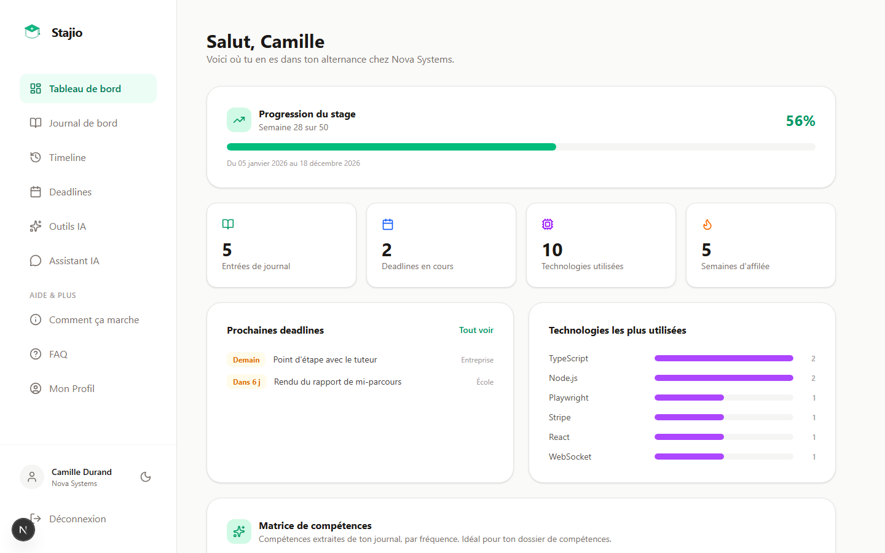
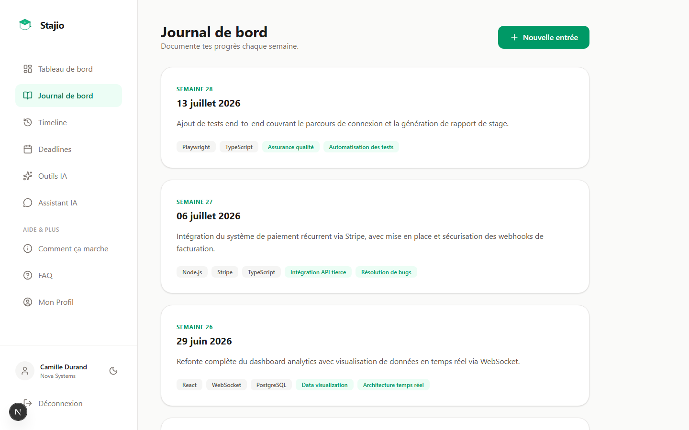
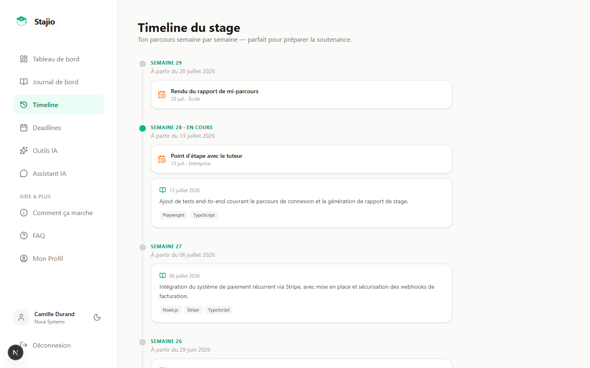
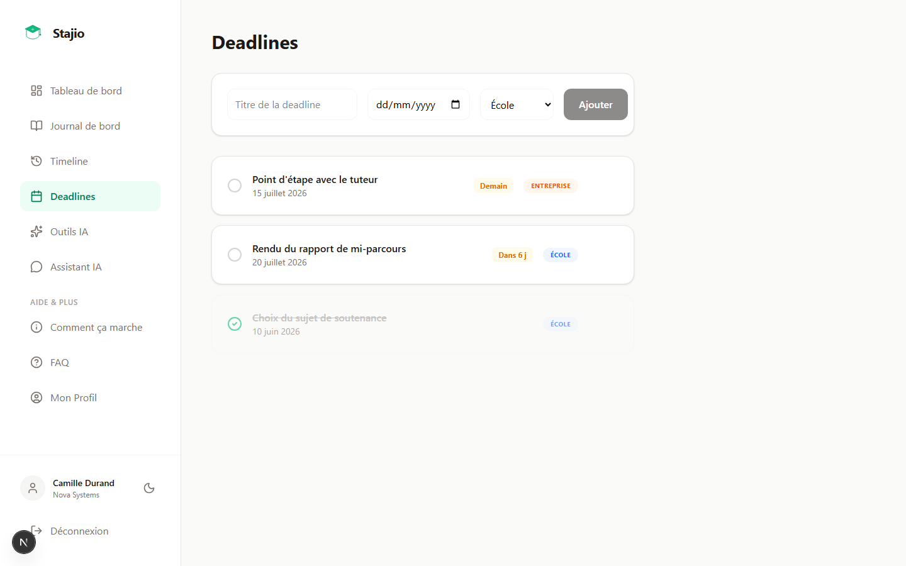
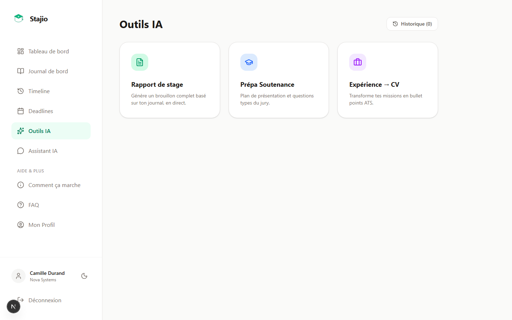
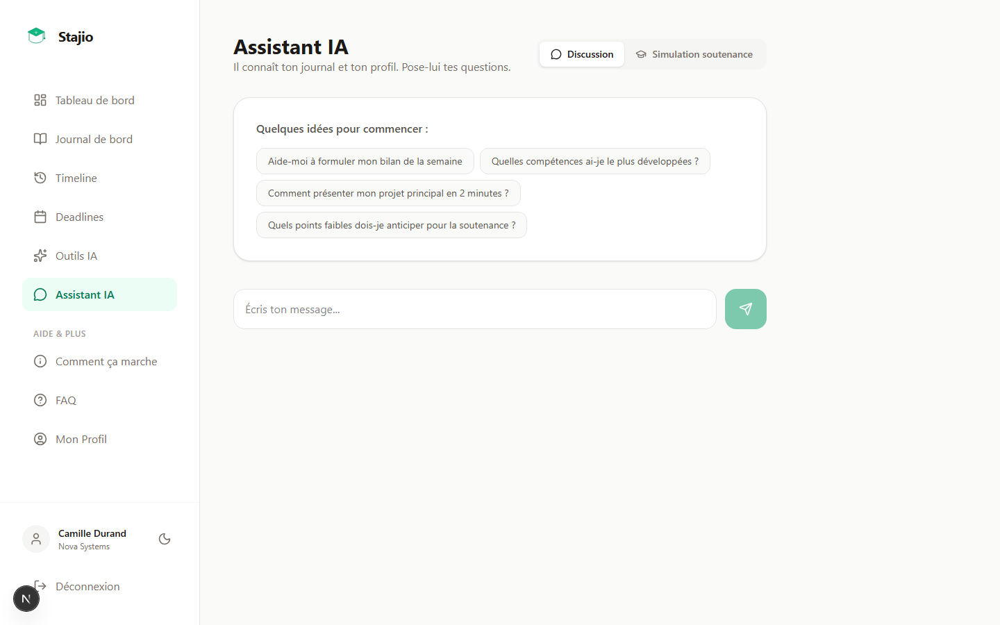
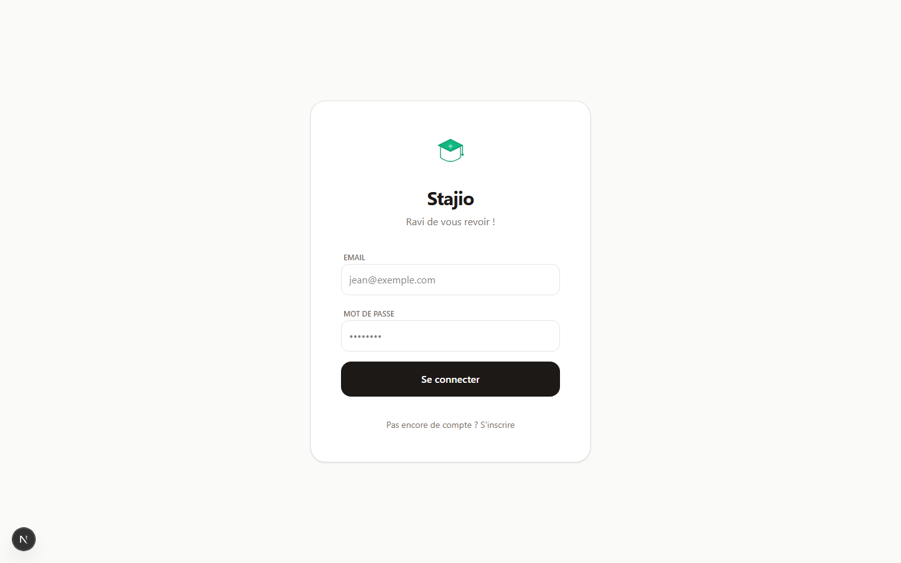
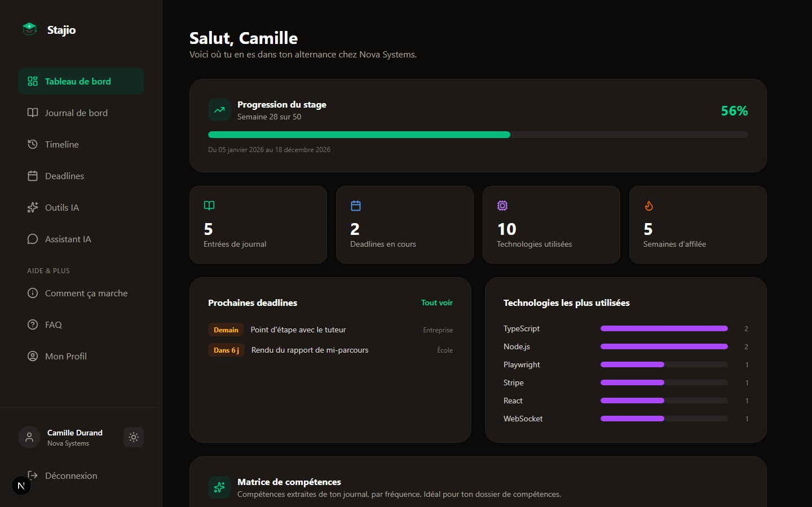

<div align="center">
  
  <h1>Stajio</h1>
  <p><strong>Assistant intelligent de suivi d'alternance et de stage, en local-first.</strong></p>

  <p>
    <a href="https://nextjs.org/"></a>
    <a href="https://react.dev/"></a>
    <a href="https://ollama.com/"></a>
    <a href="https://www.sqlite.org/"></a>
    <a href="https://www.typescriptlang.org/"></a>
    <a href="https://www.docker.com/"></a>
  </p>
</div>

## Aperçu

Stajio aide un étudiant en stage ou en alternance à transformer ses notes d'activité en preuves de compétences et en livrables adaptés à son école : rapport révisable, préparation de soutenance, points CV. Les données restent sur sa machine et l'IA locale (Ollama) est facultative : elle propose, l'étudiant relit et valide.

Le projet est local-first : aucune donnée ni aucun appel IA ne transite par un service cloud tiers. Toute la stack (base de données, inférence du modèle) tourne sur la machine de l'utilisateur.

## Démo

L'application n'a pas de démo hébergée publiquement : elle repose sur Ollama tournant en local, ce qui est la contrainte du choix local-first (pas de dépendance à une clé API cloud, pas de coût d'inférence, données jamais envoyées à un tiers). La section [Installation locale](#installation-locale) permet de la lancer en moins de 5 minutes.

| Tableau de bord                                       | Journal de bord                                     |
| ----------------------------------------------------- | --------------------------------------------------- |
|  |  |

| Timeline du stage                             | Échéances                                       |
| --------------------------------------------- | ----------------------------------------------- |
|  |  |

| Outils IA                                   | Assistant IA                                       |
| ------------------------------------------- | -------------------------------------------------- |
|  |  |

<details>
<summary>Voir aussi : écran de connexion et thème sombre</summary>
<br />

| Connexion                                  | Thème sombre                                            |
| ------------------------------------------ | ------------------------------------------------------- |
|  |  |

</details>

## Fonctionnalités

- **Configuration guidée** : profil du stage puis échéances initiales proposées (mi-parcours calculé, rendu du rapport), facultatives et à confirmer ; reprise d'une configuration interrompue.
- **Journal de bord sans IA obligatoire** : note datée librement (avertissement hors période), recherche texte et filtre de dates, brouillon enregistré automatiquement par compte, correction manuelle du résumé, des missions, technologies et compétences. La structuration par l'IA est une proposition à relire ; le texte d'origine n'est jamais remplacé.
- **Compétences** : liste validée par l'étudiant (objectif, niveau déclaré « à travailler / en pratique / autonome »), preuves reliées aux notes, renommage et fusion des doublons, suggestions issues du journal.
- **Échéances** : échéances en retard et proches affichées à l'ouverture, invitation à compléter le journal, export calendrier `.ics`.
- **Rapport révisable** : brief (consignes d'école, problématique, longueur, période, notes sources), informations manquantes signalées, plan modifiable ou proposé par l'IA, rédaction section par section en Markdown avec aperçu, enregistrement automatique, versions nommées et restauration, passages « [À compléter : …] » surlignés, validation finale, provenance (modèle, date, consignes, instantané des notes), export Markdown et PDF (page de titre, sections paginées).
- **Assistant** : conversations enregistrées, reprises, renommées ou supprimées ; réponse interrompue conservée et relançable sans doublon.
- **Simulation de soutenance** : sessions sauvegardées et reprenables, réponse enregistrée avant l'évaluation, critères visibles, note présentée comme indicative, bilan par session.
- **Points CV** : choix des expériences, génération annulable, correction et sauvegarde, chiffres manquants signalés au lieu d'être inventés, export texte ou Markdown.
- **IA locale fiabilisée** : diagnostic (Ollama joignable, modèle installé, commande `ollama pull`), entrées et sorties validées par schéma, délai maximal et annulation propagée jusqu'à Ollama, flux d'événements qui distingue fin normale, erreur du modèle et interruption, limite de contexte explicite (aucune troncature silencieuse).
- **Données** : sauvegarde JSON v3 de toutes les données métier du compte (profil, notes, échéances, compétences et preuves, rapports et versions, conversations, simulations, résultats IA, brouillons), aperçu puis remplacement transactionnel sans doublon ; conversion des exports v1 et v2.
- **Compte** : JWT en cookie HTTP-only, changement de mot de passe avec révocation des sessions, suppression confirmée des données ou du compte, récupération locale.
- Interface responsive, thème clair / sombre, formulaires étiquetés et boutons à icône nommés.

## Architecture

- **Frontend** : Next.js 16 (App Router) + React 19, Tailwind CSS 4
- **Backend** : Route Handlers Next.js (`app/api/*`)
- **Base de données** : SQLite (`better-sqlite3`)
- **IA** : Ollama en local (modèle configurable, ex. `phi4-mini`)
- **Conteneurisation** : Docker (build multi-stage) + Docker Compose (app + Ollama + volumes persistants)

### Points techniques

- Aucune clé API cloud requise pour l'IA
- Données utilisateur stockées localement en SQLite
- Séparation claire front / backend via une couche d'API interne (`src/services`)
- Routes IA : `/api/ai` (tâches JSON validées), `/api/ai/stream` (événements NDJSON `meta` / `delta` / `done` / `error`), `/api/ai/estimate` (taille du contexte), `/api/ai/status` (diagnostic)
- Les notes sources sont chargées par le serveur à partir de leurs identifiants : un compte ne peut jamais envoyer les notes d'un autre au modèle
- Données persistantes : `/api/reports` (+ versions), `/api/skills`, `/api/conversations`, `/api/simulations`, `/api/drafts`, `/api/onboarding`, `/api/deadlines/calendar`
- Disponibilité : `/api/health` (application, base, Ollama), utilisé par le healthcheck Docker et la sonde Kubernetes
- La base SQLite s'ouvre à la première requête : `next build` ne la touche pas
- Export / import de toutes les données (`/api/export`, `/api/import`)
- Validation systématique des entrées API avec Zod, avec messages d'erreur détaillés

## Installation

Cloner le dépôt dans tous les cas :

```bash
git clone https://github.com/Nadjide/stajio.git
cd stajio
```

### Avec Docker (recommandé)

Le dépôt fournit un `Dockerfile` (build multi-stage : dépendances, compilation, image de production minimale sans outils de build, utilisateur non-root) et un `docker-compose.yml` qui orchestre l'application et Ollama ensemble, avec des volumes dédiés pour que les données et les modèles survivent aux redémarrages.

```bash
cp .env.example .env
node -e "console.log(require('node:crypto').randomBytes(32).toString('hex'))"
```

Reporter la valeur générée dans `JWT_SECRET` dans `.env`, puis démarrer :

```bash
docker compose up -d --build
```

Au premier démarrage, récupérer un modèle dans le conteneur Ollama :

```bash
docker compose exec ollama ollama pull phi4-mini
```

Application disponible sur `http://localhost:3001`. Ollama est accessible en interne par l'application via le réseau Docker (`http://ollama:11434`) et exposé sur l'hôte sur le port `11434` si besoin d'y accéder directement.

Les ports de Stajio et d'Ollama sont liés à `127.0.0.1` : ils sont accessibles depuis ce poste. Le fichier `.env` permet aussi de configurer `OLLAMA_MODEL`, `OLLAMA_NUM_CTX` (fenêtre de contexte, 8192 jetons par défaut), `OLLAMA_TIMEOUT_MS` (durée maximale d'une génération, 5 minutes par défaut), `STAJIO_COOKIE_SECURE` et `STAJIO_DB_PATH` (chemin dans le conteneur, par défaut `/app/data/stajio.db`).

Pour tout arrêter : `docker compose down` (les données restent dans les volumes nommés ; ajouter `-v` pour les supprimer aussi).

### Installation manuelle (sans Docker)

1. Installer les dépendances

```bash
npm install
```

2. Configurer l'environnement

```bash
cp .env.example .env
```

Configurer un `JWT_SECRET` aléatoire d'au moins 32 octets avec la commande indiquée ci-dessus permet de garder les sessions entre redémarrages. En développement sans secret, Stajio génère une valeur temporaire ; redémarrer le serveur déconnecte les comptes. La production refuse un secret absent, trop court ou d'exemple.

3. Lancer Ollama et récupérer un modèle

```bash
ollama serve
ollama pull phi4-mini
```

4. Démarrer l'application

```bash
npm run dev
```

Application disponible sur `http://localhost:3001`.

## Scripts utiles

- `npm run dev` : développement
- `npm run build` : build production
- `npm run start` : démarrage production (nécessite un build)
- `npm run lint` : vérification des types TypeScript
- `npm run lint:code` : lint ESLint
- `npm run format` : formatage Prettier
- `npm run test` : tests unitaires et API (Vitest)
- `npm run test:e2e` : tests end-to-end (Playwright ; nécessite `npx playwright install chromium` une première fois)
- `npm run check` : pipeline complète (lint + tests + build)
- `npm run db:recover -- --backup <fichier> --output <nouveau-fichier>` : récupérer une sauvegarde SQLite sur une copie
- `npm run account:reset-password -- --db <base-existante> --email <adresse>` : récupération locale avec saisie cachée du nouveau mot de passe

## Qualité logicielle

- ESLint (config Next.js + hooks React)
- Prettier avec plugin Tailwind
- Vitest : tests de validation, de repositories (isolation par utilisateur) et de routes API
- Playwright : parcours de bout en bout (configuration interrompue puis reprise, journal sans Ollama, structuration simulée, rapport corrigé, versionné et exporté, sauvegarde et restauration, sécurité du compte)
- CI GitHub Actions : lint, tests, build et E2E sur chaque push et pull request

Les tests Vitest utilisent une base SQLite en mémoire distincte par suite, même si `STAJIO_DB_PATH` est défini dans le shell. Les tests Playwright lancent un serveur dédié sur `127.0.0.1:3101`, avec une copie des sources et une base temporaire ; ils refusent de réutiliser un serveur existant.

Les évolutions SQLite passent par des migrations versionnées et une sauvegarde automatique avant modification d'une base existante. La [procédure de récupération sur une copie](docs/DATA_RECOVERY.md) décrit la commande `npm run db:recover` et son usage avec Docker.

La [documentation du format JSON](docs/BACKUP_FORMAT.md) précise les données sauvegardées, la compatibilité des anciens exports et le remplacement transactionnel du compte après aperçu et confirmation.

## Sécurité

- Mots de passe hashés avec bcrypt, jamais renvoyés par l'API
- JWT signé (`JWT_SECRET`), stocké en cookie HTTP-only
- Toutes les routes de données sont scoped par utilisateur (un utilisateur ne peut lire ni modifier les données d'un autre)
- Validation stricte des entrées (Zod) sur l'ensemble des routes API
- En production : HTTPS obligatoire et secret JWT robuste et dédié

Pour une installation accessible sur un réseau, placer Stajio derrière un reverse proxy HTTPS et définir `STAJIO_COOKIE_SECURE=true`. Le proxy doit transmettre les cookies et préserver le streaming. Le mode HTTP local utilise `STAJIO_COOKIE_SECURE=false` et des cookies HTTP-only avec `SameSite=Lax`. Garder Ollama sur le réseau interne ou l'interface locale. Toutes les routes IA, y compris la liste des modèles, exigent une session valide.

La [gestion du mot de passe et du compte](docs/ACCOUNT_RECOVERY.md) décrit le changement depuis le profil, la récupération réservée au propriétaire de la machine et les suppressions confirmées. Changer ou récupérer le mot de passe invalide les anciennes sessions.

## Dépannage

- **« Ollama est injoignable »** : lancer `ollama serve` (ou `docker compose up -d ollama`), puis « Vérifier » dans Mon Profil. Le journal, les échéances et le rapport restent utilisables.
- **« Le modèle … n'est pas installé »** : `ollama pull phi4-mini` (ou `docker compose exec ollama ollama pull phi4-mini`), ou choisir un modèle installé dans Mon Profil.
- **« La sélection est trop longue pour le modèle »** : réduire la période ou décocher des notes dans le brief ; à défaut, augmenter `OLLAMA_NUM_CTX` si la machine a assez de mémoire.
- **Génération trop lente** : la durée dépend du matériel ; arrêter la génération, réduire la sélection ou augmenter `OLLAMA_TIMEOUT_MS`.
- **État du service** : `curl http://127.0.0.1:3001/api/health` indique séparément l'application, la base et Ollama.
- **Mise à jour** : sauvegarder ses données (Mon Profil > Exporter tout), mettre à jour le dépôt puis reconstruire (`docker compose up -d --build`). Les migrations SQLite prennent un instantané dans `backups/` avant toute modification ; voir la [procédure de récupération](docs/DATA_RECOVERY.md).

## Spécification et roadmap

La [spécification V1](docs/SPEC_V1.md) décrit la promesse, les règles métier (période, semaines, notes hors période), le vocabulaire de l'interface et le scénario de recette, avec un [jeu de données fictif](docs/fixtures/demo-backup.json) importable depuis Mon Profil. Les [exemples de référence IA](docs/AI_REFERENCE_EXAMPLES.md) servent à relire les résultats d'un modèle réel. La [roadmap V1](docs/ROADMAP_V1.md) suit l'état de chaque tâche et les [notes de version](docs/RELEASE_NOTES.md) résument ce qui est livré.

## Points forts du projet

- Cas d'usage réel et concret pour un public précis (étudiants en alternance / stage)
- Architecture full-stack moderne avec séparation nette des responsabilités
- Intégration d'une IA locale plutôt qu'un simple appel à une API cloud : contrainte technique assumée et différenciante
- IA traitée comme une proposition vérifiable : schémas de sortie, provenance des générations, annulation, marqueurs « à compléter » au lieu d'inventions
- Couverture de tests à plusieurs niveaux (unitaire, API, end-to-end) et CI configurée
- Conteneurisation complète (image de production minimale, utilisateur non-root, healthchecks, volumes persistants) pour un déploiement reproductible

## Licence

MIT — voir [LICENSE](LICENSE).
